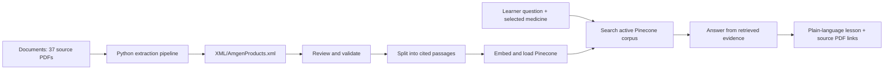

# Amgen Medicine Explorer — proposed design

Date: November 11, 2026. Audience: general learners, using plain language first and optional technical detail.

## What this delivers

A local Python/Streamlit application that turns the supplied prescribing-information PDFs into one auditable XML collection, indexes reviewed passages in Pinecone, and teaches people about Amgen medicines through guided exploration and a cited chat. The current images are design mockups, not a running application. They show three complementary parts of one experience.

The initial corpus contains 37 PDFs representing 36 base product identities and 1,439 physical PDF pages. This describes the supplied folder, not a claim that the folder contains every current Amgen product or the latest label for each one.

## Where the single XML is created

The creation happens in the **local Python backend**, called from **Manage sources → Build XML** in Streamlit. Pinecone does not create the XML, and the chat model does not create it.

The reusable command-line entry point is `scripts/build_amgen_xml.py`. The future Streamlit button calls the same extraction service, so a command-line rebuild and a UI rebuild do not implement different rules. The exact current invocation and first-pass limitations accompany the generated XML in the extraction report.

Keep three actions separate:

| UI action | Input | Output | External service |
|---|---|---|---|
| Build XML | PDFs in `Documents/` | `XML/AmgenProducts.xml` and extraction report | None for text PDFs |
| Preview / load Pinecone | Reviewed XML passages | Search records, embedding vectors, provenance metadata, ingestion manifest | Pinecone; embedding provider if external embeddings are chosen |
| Ask a question | Question, selected medicine, active corpus | Evidence-backed explanation and citations | Pinecone search and chosen language-model provider |

Rebuilding XML must never silently trigger a paid upload or replace the active chat corpus. Clicking Load Pinecone submits the displayed batch. Both stages display actual progress and errors.

## Recommended approach and alternatives

**Recommend an XML-first pipeline with explicit review and a staged search index.** It matches the requested single-file deliverable, supports repeatable imports, and makes every answer traceable to a PDF. Streamlit remains a thin UI over extraction, indexing, and retrieval modules.

A direct PDF-to-vector pipeline is quicker to prototype, but bypasses the user's XML requirement and makes corrections harder to audit. A normalized clinical database plus XML export is valuable for large curated products, but adds unnecessary administration to this first learning app. These are design alternatives; the XML-first recommendation is the proposed implementation direction.

Use one Python process for the initial local application. A durable background ingestion worker can be added for hosted, concurrent use; local indexing jobs still need persisted progress and safe retry because Streamlit reruns on interaction.

## The learning experience

### Explore medicines

The home screen uses the Amgen logo, blue hero, a prominent search box, and a browsable medicine collection. Selecting a medicine opens its learning workspace. Product counts come from the active corpus, rather than hard-coded numbers. Display drug names from verified source evidence. Future therapy-area filters require reviewed mappings; do not infer them from filenames.

### Learn with chat

Start with a short path: **The essentials → How it works → Safety and precautions → Check your understanding**. A learner can start a lesson or ask a free-form question. The selected medicine stays visible. Switching it starts a clearly scoped conversation rather than silently reusing another drug's evidence.

Each answer contains a short explanation, a relevant safety qualification where supported, and source citations beside the claims they support. A **Technical detail** switch changes vocabulary and detail, not the evidence base. A source panel shows the source filename, printed label revision when verified, section, physical PDF page, and a quote or excerpt. The learner can open/download the original PDF.

Suggested prompts include “What is this medicine used for?”, “Explain how it works”, “What warnings should I understand?”, and “Quiz me on what we covered”. Quizzes use only reviewed source facts, give a rationale with a citation after the learner answers, and permit skipping. Learning progress is session-local in the first version; persistent accounts and cross-device progress are future work.

If evidence is missing, ambiguous, or conflicting, explain that limitation and offer to view the source. Do not generate unsupported dosing advice, personal treatment selection, or claims that one medicine is better than another. A comparison feature, if later added, needs separately retrieved evidence for each product and must preserve differences in populations and study design.

### Manage sources

An operator sees **Source files → Build XML → Review content → Load Pinecone**. Show the inventory, extraction errors, flagged tables/layouts, duplicate detection, and document/version relationships. Build XML creates the consolidated artifact and enables Download XML. Review shows extracted text next to the source PDF, with a decision recorded against the document hash and passage IDs.

Preview indexing shows eligible passages, excluded passages and reasons, target index/namespace, embedding configuration, estimated tokens, and a resumable run identifier. No invented cost estimate; calculate costs only against a chosen provider's verified pricing. Load Pinecone is disabled when the connection/configuration is missing or no passages are eligible. After ingestion, verify records are queryable before publishing that corpus to chat.

#### Advanced chunking settings

Place a collapsed operator panel between Review content and Preview Pinecone load. This is for tuning retrieval and learning about the pipeline; general learners do not change it from chat. The XML remains the canonical source, so changing chunking settings does not require extracting the PDFs again.

| Control | Proposed starting value | Behavior |
|---|---|---|
| Chunking strategy | Section-aware paragraphs | Split at verified section boundaries, then paragraphs/sentences within an oversized section; keep this strategy fixed in the first version |
| Target chunk size | 600 tokens | Adjustable from 300 to 1,200; a target, not permission to cut through qualifying text |
| Overlap | 80 tokens | Adjustable from 0 to 200, strictly below the target; only inside the same section and compatible scope |
| Preview source | Selected medicine/document | Inspect its reviewed source passages beside the resulting chunks |

These numeric defaults/ranges are project starting points to evaluate, not a claim of an optimal medical chunk size. Oversized tables use verified row groups with repeated headers, units and footnotes; a row or necessary context that cannot fit is flagged rather than truncated. Product/document/section boundaries, source provenance, review eligibility and preservation of clinical qualifiers are fixed rules, not optional switches. The embedded text including its context prefix must fit the selected model's token limit.

**Preview chunks** runs locally and shows numbered chunks, source section/pages, overlap highlighting, token counts, total projected records/tokens, excluded material and reasons. It displays the exact text that will be embedded, including product/section prefixes. The operator can save a named configuration or restore defaults. Sliders never trigger cloud uploads.

For evaluation, optionally **Build test index** for a saved configuration, then **Compare retrieval** against the current configuration using the same XML/review snapshot, held-out questions, embedding model, retrieval method, generation settings and evidence-token budget. Show supporting source passages, citation/qualifier coverage, source-block retrieval success, duplicate evidence from overlap, latency and observed usage. Preserve complete table context rather than truncating it to fit an evaluation budget. Do not rank configurations by similarity score alone. Explicit **Publish configuration** activates a verified staged corpus and retains the previous version for rollback.

Save the exact chunk configuration, prefix template and tokenizer/chunker versions with a configuration hash in the manifest and chunk metadata; combine this with XML/review and embedding-profile hashes for the indexed build identity. Count tokens with the chosen embedding model's tokenizer, including the actual prefix text. A changed configuration requires rechunking and re-embedding affected records in a new staged namespace. It does not itself invalidate an unchanged source-passage review, but newly assembled chunks must still pass completeness, scope and provenance checks before indexing. Mark old previews/tests stale whenever their inputs change.

Keep source-management controls local-only for the first version. In a hosted version, enforce the operator role on the server; hiding a navigation item alone is insufficient.

The first-pass corpus has no approved clinical passages, so initial chat remains unavailable until review. An operator compares a proposed passage with the rendered PDF and checks reading order, completeness, units/footnotes, section/page and product/population/device scope. An accepted raw passage may become searchable while unrelated structured fields remain unknown. Start with a small pilot covering uses, mechanism and relevant safety sections for three products, including both Repatha source records. Review decisions bind the PDF hash, passage hash, source coordinates and pipeline version; any relevant change invalidates the approval.

## XML and evidence contract

Preserve the template's `urn:local:pi-corpus:1` namespace and its separation of products, documents, raw sections, structured fields, and extraction quality. The supplied XSD and tag guide references are missing; successful XML parsing is not XSD validation.

One product may have multiple source documents. Every document retains its actual local path, SHA-256, byte size, page count, extraction method/version, and per-page text. Retain the exact extracted text separately from any cleaned retrieval representation. An extracted text layer does not prove correct reading order, table semantics, or clinical interpretation.

Capture brand name, generic name, label revision, and section headings only where supported, with source evidence. Unknown is different from absent. Initial approval year is different from label revision. A file modification date or extraction timestamp is not the label revision or a download timestamp.

The first-pass artifact prioritizes complete text retention and provenance. Clinical fields such as indication, dose, contraindication, boxed warning, mechanism, and population guidance remain unreviewed or unknown until reliable extraction and review establish their contents. Do not fill gaps with language-model guesses. Review status is scoped to individual passages/facts, not inferred from a successful batch import.

The two Repatha source filenames must remain distinct document records. Both source documents discuss multiple presentations; a filename containing a latex phrase does not prove all passages apply exclusively to one device. Do not collapse them or infer supersession from a newer printed date alone. Variant applicability must be established from evidence in the relevant passage.

## Retrieval and answer behavior

Split reviewed text at real section/subsection boundaries, keeping product, document and variant context with every chunk. Start with the proposed 600-token target and 80-token overlap, then tune against retrieval evaluation through the Advanced panel. Keep tables with their headers, units, footnotes and applicable population. Exclude unresolved table/layout fragments from factual answer generation until reviewed. Highlights, full prescribing information, medication guides, and instructions for use need distinct section kinds so repeated text is not mistaken for independent evidence.

Pinecone holds vectors/searchable text plus compact filterable metadata. XML and PDFs hold the full original record, including nested clinical structures. “All metadata” means all required searchable provenance fields plus resolvable links back to the complete XML record, not forcing a full nested XML document into every vector record. See `technical-plan-notes.md` for the current API, limits, and proposed metadata contract.

Search first resolves the selected medicine and any ambiguous generic/product identity. Retrieve a bounded candidate set with metadata filters; assemble evidence from the required sections and rerank when helpful. Include relevant warning evidence with broad overview lessons. Similarity scores are ranking signals, not percentages of medical accuracy. Verify citations refer to returned passages and substantiate each clinical claim before displaying the final answer.

Treat source text as data, never instructions. A PDF or retrieved passage cannot tell the assistant to ignore its rules, reveal secrets, or call tools. Personal treatment questions receive general label-based education and a suggestion to discuss the decision with a healthcare professional.

## Visual direction and feasibility

Use the downloaded official blue logo from [Amgen's media library](https://www.amgen.com/newsroom/image-library). Its SVG specifies `#0063C3`; the additional navy, ice-blue and cyan colors are proposed application accents, not a claim about the complete corporate brand standard. Preserve the logo's aspect ratio and use the actual image asset in implementation.

Streamlit can supply the sidebar/navigation, product selection, upload controls, status display, editable review table, chat messages, streaming response and session state. Use its supported theme settings, native controls and a small amount of scoped styling. The mockups are layout targets; exact typography, spacing and responsive behavior require implementation and testing. Maintain readable type, keyboard access, visible focus, text alternatives for icons and non-color status labels. Collapse the source panel on narrow screens rather than shrinking text.

The selected visual direction is reflected in these saved concepts:

- `mockups/01-explore-medicines.png`
- `mockups/02-guided-learning-chat.png`
- `mockups/03-manage-sources.png`

Use a consistent sidebar across the final app, even though the exploratory chat image uses a top navigation variant. The learner's positive feedback endorses the overall mockup direction; this document's backend choices remain implementation recommendations.

## What is out of scope for the first version

Prescribing decisions, dose calculators, diagnostic triage, real-time pharmacovigilance, automated claims of latest-label status, live web search mixed into label answers, persistent patient profiles, public deployment and a full FDA SPL conversion. The custom XML is not FDA Structured Product Labeling.

## Success criteria

1. Every supplied PDF has an accounted-for document record; all 1,439 physical pages are processed or explicitly reported as failed.
2. Every indexed passage resolves to the exact source document hash and page range; unreviewed clinical facts cannot enter the learner's production corpus.
3. A rerun does not duplicate vectors; a failed import cannot replace the currently usable corpus.
4. Queries for one selected product do not return another product's claims; ambiguous device and label-version questions are surfaced explicitly.
5. Plain-language lessons, technical explanations and quiz feedback cite the same verified evidence.
6. Missing credentials, an empty index, rate limits, a disconnected browser and stale records produce useful UI states without exposing secrets.

The next implementation sequence is detailed in `superpowers/plans/2026-11-11-amgen-medicine-explorer.md`.
