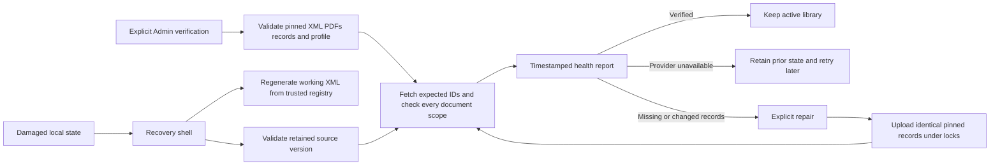

# Amgen Medicine Explorer architecture

The local Streamlit application separates whole-library administration, global discovery and source-scoped teaching. This document supersedes the original manual-passage pilot architecture. Current release verification belongs in the [condition-search release report](implementation/condition-search-release.md); this document does not assert a new live deployment or measured retrieval outcome.

## Solution

[Editable SVG](diagrams/01-solution-architecture.svg)

| Layer | Responsibility |
|---|---|
| Streamlit | Search & Learn; educational Test App notice beside Amgen branding; Admin Library and chunk experiments; session learning and prepared demo |
| Source services | Authoritative inventory, transactional PDF import, consolidated XML, automatic eligibility and exact-span coverage |
| Index services | Resumable full-library namespace builds, matching immutable lexical artifacts, verification and atomic activation |
| Discovery | Local FTS5/deterministic lexical search plus whole-namespace semantic search, strict hit validation, rank fusion and grouped results |
| Teaching | One selected medicine/document/run; bounded evidence, OpenAI explanation checks and retained PDF citations |

Full PDFs and XML stay local. Pinecone receives chunk text plus flat provenance metadata. OpenAI receives selected evidence, a question and relevant conversation context. Neither provider creates the consolidated XML. Provider credentials remain in server-side Python.

## Data flows

[Editable SVG](diagrams/02-data-flow.svg)

**Build:** Admin explicitly validates every registered source, builds/reuses the single XML, assesses source verification and readable-text coverage, chunks all documents, uploads a separate namespace, builds local search, verifies both and activates one complete manifest. A failed build leaves the previous pointer intact. Uploading PDFs locally is distinct from sending extracted chunks to Pinecone.

**Discover:** An explicit submission pins a verified run. Its exact records and lexical artifact are validated before any provider call. Search spans body text, section headings, brand and generic names. Semantic hits must equal immutable local records and meet the same scope/policy. Query interpretation recognizes catalog names inside questions, meaningful terms and section intent. Treatment/prevention questions separate intent from condition terms and require a positive use relation for that medicine in the pinned source. Indications rank ahead of supporting patient/study passages; incidental, adverse and negated uses do not qualify. Exact linked indication headings and source continuations travel as complete groups. Results are not padded to the configured limit. Relevance gates precede ranking; diversity applies among relevant candidates. Typo/ambiguous-name suggestions require explicit selection. Runtime ranking is versioned separately from immutable v1 lexical artifacts. Provider outage yields labeled local-only degraded results; a changed local artifact fails closed.

**Teach:** Selecting a result carries its product, document and run into the conversation. Retrieval, quiz, re-explanation and source resolution retain that run. A shared evidence policy checks source identity, layout and continuation completeness. `condition_evidence.py` supplies one treatment-use rule for discovery and `condition_context()` before evidence packing. Both semantic and local fallback retrieval filter the complete candidate context before expansion. The final teaching/quiz boundary checks the actual question again, including saved evidence and re-explanation. A mismatched treatment bundle cannot become a source-only fallback. Complete linked groups also accompany claim verification, output citations and quoted fallback; a fragment-dependent quiz declines safely. Non-treatment contexts retain their existing selection policy; knowledge checks currently retrieve mechanism evidence. Atomic evidence groups allocate requested facts and safety context together. Semantic failure uses validated scoped local search. Personal-treatment routing precedes retrieval; fixed educational follow-ups and source-reading quizzes share the evidence gate. A 60-second cooperative response budget caps remaining request time and rejects late generation. Later activation changes fresh searches, not existing conversations. `SearchResults` is a discovery contract; it is distinct from the single-source `EvidenceBundle` sent to teaching.

**Experiment:** Draft chunk settings affect only local preview. Test settings builds an isolated full-library candidate and measures the same saved cases against a compatible active baseline. Use configuration changes the pointer only after verification. Default/current-control resets make no provider calls. Revert restores a retained verified version.

## Deployment and persistence

[Editable SVG](diagrams/03-deployment.svg)

Local mode uses the file/SQLite workflow and resumable ingestion checkpoints. Hosted mode rechecks the verified administrator allowlist at service operations, stores build jobs and ingestion checkpoints in managed SQL, and restores library assets through App Storage. Admin navigation is not the authorization boundary.

| Artifact | Role |
|---|---|
| `Documents/` | Registered source PDFs |
| `XML/AmgenProducts.xml` | One canonical collection with exact page archives and section spans |
| `data/source-registry.json`, `data/source-registries/` | Authoritative expected inventory and its version history |
| `data/corpora/<xml-hash>/` | Immutable XML/PDF snapshots for old citations |
| `data/manifests/` | Run manifests, immutable chunk records and run/ranking-pinned SQLite search artifacts |
| `data/active-corpus.json` | One atomic pointer binding semantic namespace and lexical artifact |
| `data/ingestion.sqlite`, `data/review.sqlite` | Batch checkpoints and preserved historical manual review |

New runs explicitly use `bulk_source_verified_v1`; legacy manifests without a policy marker use `manual_review_v1`. Automated source verification is not a human/clinical approval. Tables/layout warnings remain discoverable with source limitations. Coverage counts unique physical page character intervals, so overlap cannot inflate completeness. Blank/image-only pages are reported separately; OCR is excluded.

## Provider and configuration boundary

`config/app.toml` holds nonsecret settings. Ignored `.streamlit/secrets.toml` or exported credentials supply keys; nonblank environment values win and no `.env` loader exists. Optional search/reliability settings add backward-compatible defaults.

The Pinecone adapter uses Documents API `2026-07`, integrated `llama-text-embed-v2`, 1,024 dimensions and cosine. The existing index schema is retained. Every prefixed chunk/query passes the conservative UTF-8 byte guard. The local lexical engine uses built-in SQLite FTS5 where available and deterministic token search otherwise. OpenAI Responses requests use `store=false`; citations and material source support are checked locally.

Hosted role checks and durable full-library build recovery are implemented, but no hosted deployment or real administrator account is claimed as verified. Learner isolation and operational setup still need validation before a pilot. See [setup](configuration-and-pinecone-setup.md), [technical notes](technical-plan-notes.md) and [future work](future-features.md).

## Verification and recovery flow

Health observations live under `data/health/` separately from immutable run identity. Reports distinguish expected-record verification from an inventory of all remote records. Last successful verification remains available across outages. A generation-readiness check is a separate explicit operation with its own timestamp.

Upload retries have four total attempts by default, exponential jittered delays and a total budget; Retry-After is honored only within that budget. Authentication401/403 is not retried. Interrupted or retried provider usage may be unknown. The response deadline uses socket timeouts and cooperative checks; it is not operating-system cancellation of blocked transport work.

Native layout extraction versions separate demonstrably independent narrative from table/figure regions using geometry and exact archive offsets. Ambiguous captions, continuing tables and columns stay restricted. Page coverage reports native text versus total physical pages; no text means blank or image-only, with OCR unavailable. Source/parser changes create a distinct candidate.

Retention reports local unique storage, protected references and recorded provider usage. Cleanup remains disabled because historical publications and live in-memory conversation references do not provide durable proof that a version is unreferenced. No automatic deletion occurs. See [retention and capacity](implementation/retention-capacity.md).
