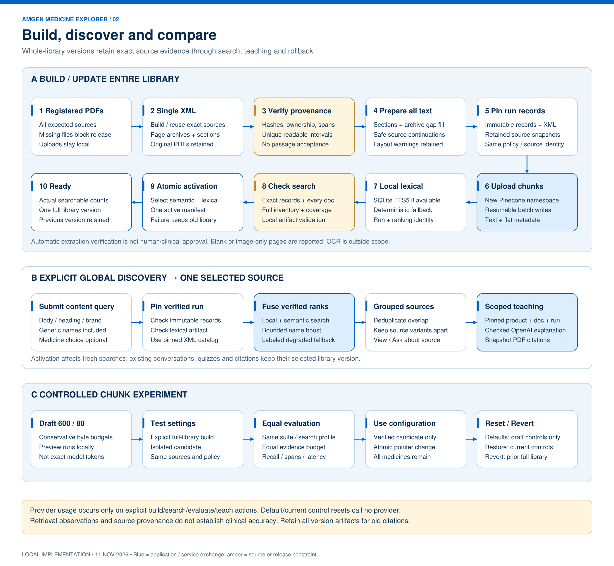

# Amgen Medicine Explorer architecture

The local Streamlit application separates whole-library administration, global discovery and source-scoped teaching. This document supersedes the original manual-passage pilot architecture. Current release verification belongs in the [bulk-refactor release report](implementation/bulk-refactor-release-report.md); this document does not assert a new live deployment or measured retrieval outcome.

## Solution

[Editable SVG](diagrams/01-solution-architecture.svg)

| Layer | Responsibility |
|---|---|
| Streamlit | Search & Learn; Admin Library and chunk experiments; session learning and prepared demo |
| Source services | Authoritative inventory, transactional PDF import, consolidated XML, automatic eligibility and exact-span coverage |
| Index services | Resumable full-library namespace builds, matching immutable lexical artifacts, verification and atomic activation |
| Discovery | Local FTS5/deterministic lexical search plus whole-namespace semantic search, strict hit validation, rank fusion and grouped results |
| Teaching | One selected medicine/document/run; bounded evidence, OpenAI explanation checks and retained PDF citations |

Full PDFs and XML stay local. Pinecone receives chunk text plus flat provenance metadata. OpenAI receives selected evidence, a question and relevant conversation context. Neither provider creates the consolidated XML. Provider credentials remain in server-side Python.

## Data flows

[Editable SVG](diagrams/02-data-flow.svg)

**Build:** Admin explicitly validates every registered source, builds/reuses the single XML, assesses source verification and readable-text coverage, chunks all documents, uploads a separate namespace, builds local search, verifies both and activates one complete manifest. A failed build leaves the previous pointer intact. Uploading PDFs locally is distinct from sending extracted chunks to Pinecone.

**Discover:** An explicit submission pins a verified run. Its exact records and lexical artifact are validated before any provider call. Search spans body text, section headings, brand and generic names. Semantic hits must equal immutable local records and meet the same scope/policy. Reciprocal-rank fusion, a bounded exact-name boost and document-balanced deduplication produce grouped sources. Provider outage yields labeled local-only degraded results; a changed local artifact fails closed.

**Teach:** Selecting a result carries its product, document and run into the conversation. Retrieval, quiz, re-explanation and source resolution retain that run. Later activation changes fresh searches, not existing conversations. `SearchResults` is a discovery contract; it is distinct from the single-source `EvidenceBundle` sent to teaching.

**Experiment:** Draft chunk settings affect only local preview. Test settings builds an isolated full-library candidate and measures the same saved cases against a compatible active baseline. Use configuration changes the pointer only after verification. Default/current-control resets make no provider calls. Revert restores a retained verified version.

## Deployment and persistence

[Editable SVG](diagrams/03-deployment.svg)

The server listens on `127.0.0.1:8501`. One local Python process uses file/SQLite locks and resumable checkpoints. Admin navigation does not implement hosted authentication.

| Artifact | Role |
|---|---|
| `Documents/` | Registered source PDFs |
| `XML/AmgenProducts.xml` | One canonical collection with exact page archives and section spans |
| `data/source-registry.json`, `data/source-registries/` | Authoritative expected inventory and its version history |
| `data/corpora/<xml-hash>/` | Immutable XML/PDF snapshots for old citations |
| `data/manifests/` | Run manifests, immutable chunk records and run/ranking-pinned SQLite search artifacts |
| `data/active-corpus.json` | One atomic pointer binding semantic namespace and lexical artifact |
| `data/ingestion.sqlite`, `data/review.sqlite` | Batch checkpoints and preserved historical manual review |

New runs explicitly use `bulk_source_verified_v1`; legacy manifests without a policy marker use `manual_review_v1`. Automated source verification is not a human/clinical approval. Tables/layout warnings remain discoverable with source limitations. Coverage counts unique physical page character intervals, so overlap cannot inflate completeness. Blank/image-only pages are reported separately; OCR is excluded.

## Provider and configuration boundary

`config/app.toml` holds nonsecret settings. Ignored `.streamlit/secrets.toml` or exported credentials supply keys; nonblank environment values win and no `.env` loader exists. The configuration shape is unchanged.

The Pinecone adapter uses Documents API `2026-07`, integrated `llama-text-embed-v2`, 1,024 dimensions and cosine. The existing index schema is retained. Every prefixed chunk/query passes the conservative UTF-8 byte guard. The local lexical engine uses built-in SQLite FTS5 where available and deterministic token search otherwise. OpenAI Responses requests use `store=false`; citations and material source support are checked locally.

Shared hosting would require server-enforced roles, durable shared storage, isolated learner state and operational recovery. No hosted deployment is claimed. See [setup](configuration-and-pinecone-setup.md), [technical notes](technical-plan-notes.md) and [future work](future-features.md).
