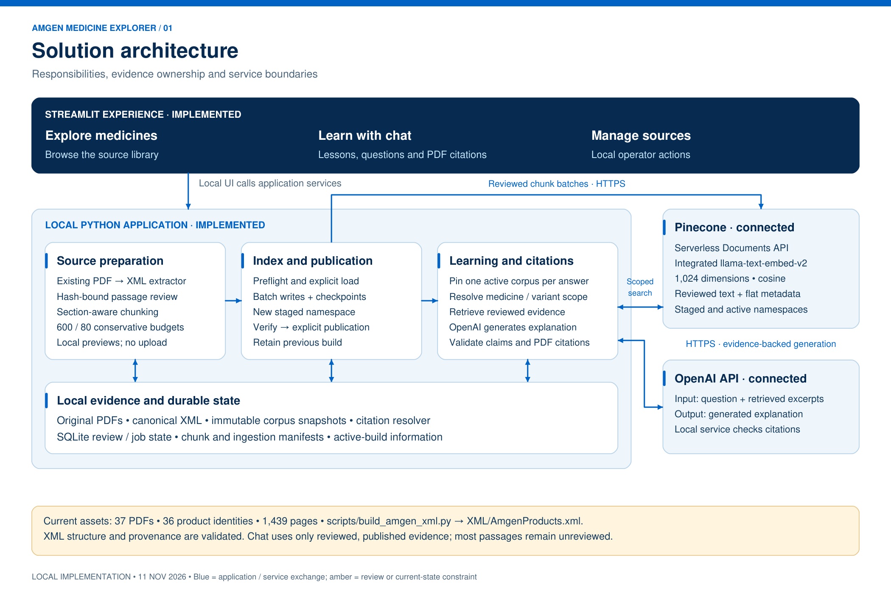
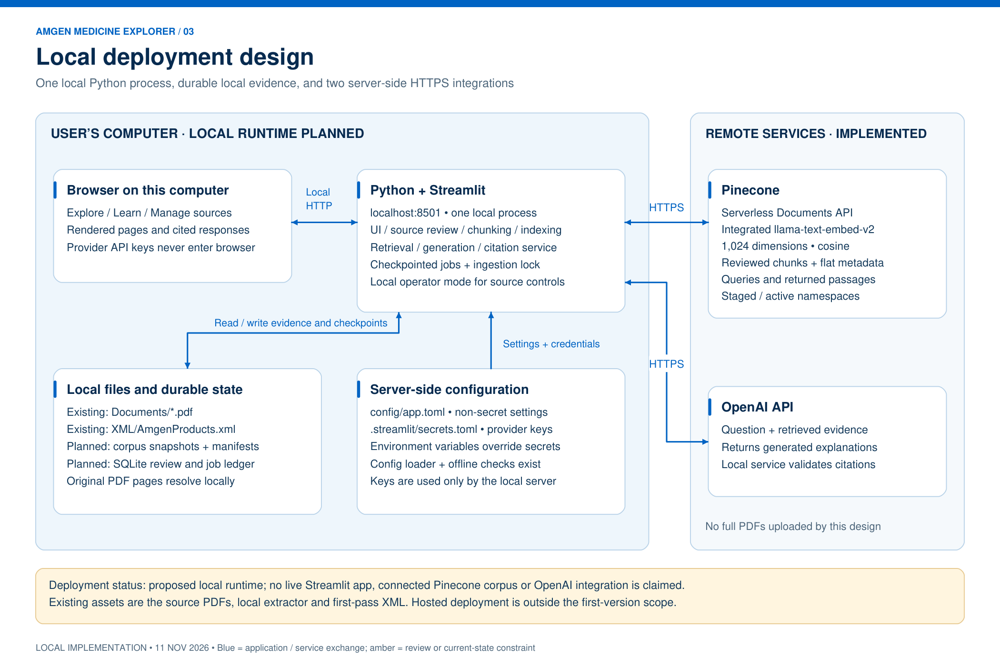

# Amgen Medicine Explorer architecture

Date: November 11, 2026. Deployment target: local Streamlit/Python on your Mac, with Pinecone and OpenAI accessed through HTTPS APIs.

This document describes the implemented local solution. The Streamlit screens, extraction/review/chunking services, Pinecone ingestion and OpenAI cited teaching are running. The initial live corpus is a limited source-fidelity pilot; broad clinical review remains separate.

## 1. Solution architecture

[Vector version](diagrams/01-solution-architecture.svg)

The application has three clear responsibilities:

| Layer | Responsibility | Where it runs |
|---|---|---|
| Streamlit interface | Explore medicines, teach through chat, and manage sources/chunking | Python server on the Mac; rendered in the local browser |
| Corpus and retrieval services | Extract XML, record reviews, create chunks, load/test indexes, retrieve evidence and resolve citations | Local Python modules |
| External APIs | Pinecone embeds and searches passages; OpenAI turns retrieved evidence into explanations | Provider-managed cloud services |

The complete PDFs and consolidated XML remain in local storage. Pinecone receives eligible passage text and compact metadata. OpenAI receives the learner's question, the selected evidence, relevant conversation context and teaching instructions. This design does not upload all PDFs to OpenAI or use OpenAI File Search as a second retrieval system.

`XML/AmgenProducts.xml` is the canonical extraction artifact. The original PDFs remain the evidence source. SQLite and manifests record review decisions, ingestion progress and the active corpus; they are application state, not substitutes for the XML.

## 2. Data flows

[Vector version](diagrams/02-data-flow.svg)

**Build and index:** An operator selects Build XML. The existing Python extractor reads `Documents/` and writes one `XML/AmgenProducts.xml`. The review screen records hash-bound decisions for eligible source passages. Chunking settings determine the searchable passages without changing the XML. Preview shows exact embedded text, source pages, conservative token bounds and exclusions. An explicit Load action sends batches to a new Pinecone namespace. Only a verified run may become the active corpus.

**Ask and teach:** The app pins the active corpus version at the start of a question, resolves the selected product/scope, and sends a filtered query to Pinecone. Pinecone embeds the query using the same embedding profile as the documents. The backend assembles supported evidence, sends it to OpenAI, checks the returned citations and displays an explanation with source links. Insufficient evidence produces a clear limitation rather than an uncited answer.

**Experiment:** Advanced chunking controls start at a 600-unit conservative token budget with an 80-unit sentence-overlap budget. A saved configuration can build a test namespace. Compare it with the current configuration using the same question set, model and evidence budget. Publish is an explicit action; moving a slider cannot replace the active corpus.

## 3. Deployment

[Vector version](diagrams/03-deployment.svg)

The first deployment needs one computer, a Python environment, a Pinecone project and an OpenAI API project. The Streamlit server listens on `127.0.0.1:8501`. API keys are loaded by server-side Python from environment variables or the ignored local secrets file; they are not sent to the browser.

The existing `amgenproduct` Pinecone index in AWS `us-east-1` is configured and verified. OpenAI model access and actual generation have also been tested with the supplied credentials.

For future shared hosting, move the same Python services into a managed application/container host, store source artifacts and manifests durably, use a secret manager, and enforce operator authorization on the server. Add a durable job worker if long imports or concurrent operators require it. Public hosting is outside this configuration task and has not been performed.

## Configuration boundaries

| File | What belongs there |
|---|---|
| `config/app.toml` | Paths, Pinecone index/model settings, chunking parameters, retrieval budgets and OpenAI model settings |
| `.streamlit/secrets.toml` | Local `PINECONE_API_KEY` and `OPENAI_API_KEY`; excluded from Git |
| `.streamlit/secrets.toml.example` | Blank credential template suitable for sharing |
| `.streamlit/config.toml` | Streamlit theme and local server settings |
| `data/active-corpus.json` | Runtime pointer to the verified index host, concrete namespace, XML hash and configuration fingerprint |

There is no `.env` loader in this setup. Exported environment variables can override the local secrets file, but a file named `.env` is not automatically read. Use one explicit secrets mechanism to avoid editing a file the application ignores. Streamlit supports the local TOML secrets convention; the project loader additionally supports CLI use without starting Streamlit. [Streamlit secrets management](https://docs.streamlit.io/develop/concepts/connections/secrets-management)

The initial runtime uses an application-owned active-corpus manifest rather than requiring a Pinecone namespace alias. The ingestion service updates this local manifest atomically only after complete verification and explicit publication. A later alias adapter is optional. Each answer must retain its initially resolved concrete namespace and XML snapshot even if the active pointer changes.

## Models and database contract

- Pinecone: Documents API, `chunk_text` string field with integrated `llama-text-embed-v2`, 1,024 dimensions, cosine distance, stored text, and a local byte-bound guard preventing truncation. The existing immutable index uses END; new indexes may use NONE. The same profile embeds documents and queries. [Pinecone integrated embedding](https://docs.pinecone.io/guides/search/integrated-embedding)
- OpenAI: configurable `gpt-6.1-sol` through the Responses API, with low reasoning effort. This is a model choice to evaluate against the source-grounded question set, not a claim of validated clinical performance. [OpenAI model documentation](https://developers.openai.com/api/docs/models/gpt-6.1-sol)
- Provenance: each search record has a product ID, document ID/hash, section/block references, PDF page range, review status, XML/corpus hash and chunk configuration hash. Preserve full nested evidence in the XML; Pinecone metadata stays compact and flat.
- Separation: changing a chunk configuration requires a staged reindex; changing the embedding schema/model requires a compatible index. Neither event silently rewrites the source XML.

## Existing versus remaining work

| Capability | Status |
|---|---|
| Extract all supplied PDF text into one XML with page provenance | Implemented and structurally validated; most passages remain unreviewed |
| Local configuration parsing and validation | Implemented and tested |
| Pinecone index dry-run/check/create utility | Existing index checked; no additional index created |
| Amgen-branded UI | Implemented; mockups retained as design references |
| Review, adjustable chunking and indexed corpus publication | Implemented and tested; limited reviewed pilot published |
| OpenAI-backed teaching chat and quizzes | Implemented and tested; limited reviewed pilot published |

Follow [configuration and Pinecone setup](configuration-and-pinecone-setup.md) to prepare local settings, then use the [implementation plan](superpowers/plans/2026-11-11-amgen-medicine-explorer.md) for design context; see README for runnable commands.
