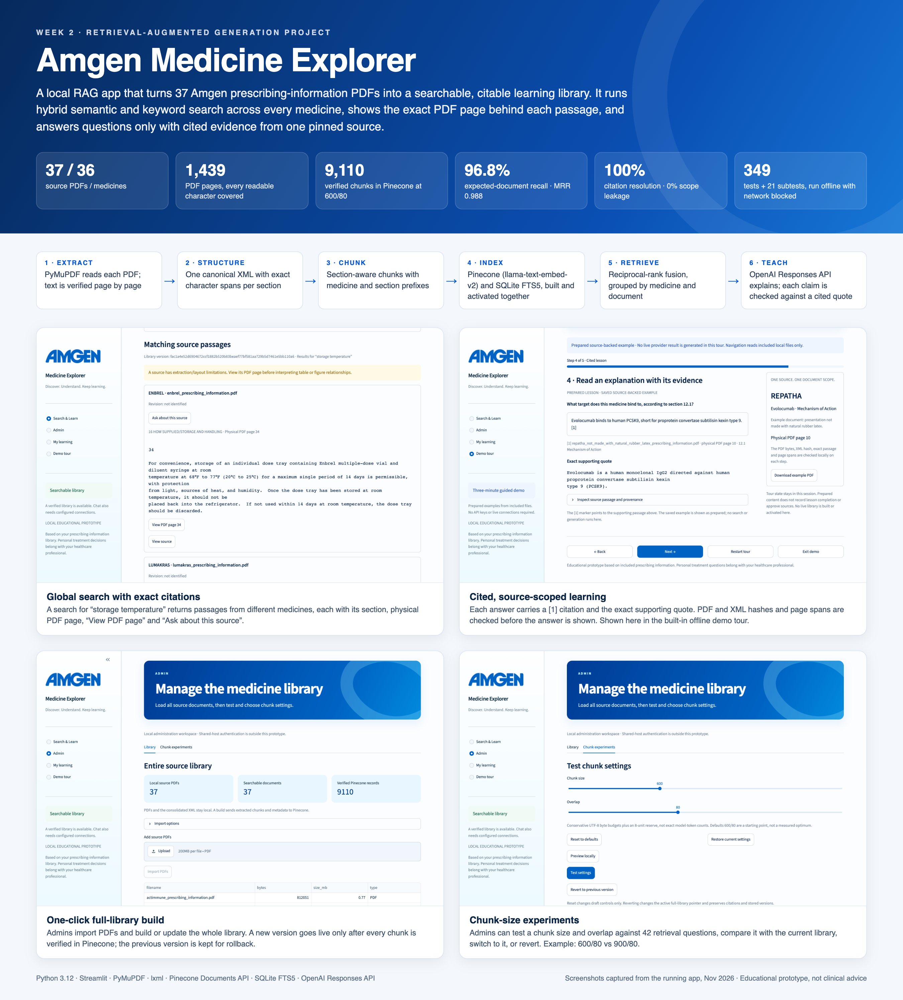

# Amgen Medicine Explorer

## One-line summary

A local retrieval-augmented generation (RAG) app that turns 37 Amgen prescribing-information PDFs into a library you can search and learn from. Every passage and answer links back to the exact page of the PDF it came from.

## What I built

Prescribing information is long, dense and spread across dozens of PDFs. Amgen Medicine Explorer lets a learner search all of it at once and then ask questions about one document. The app only answers with evidence it can cite.

**Search & Learn.** A single search box covers the body text, headings, brand names and generic names of 36 medicines (37 documents). It combines semantic search in Pinecone with keyword search in SQLite FTS5, and merges the two rankings with reciprocal-rank fusion. Results are grouped by medicine and document. Each one shows the exact excerpt, its section and its physical PDF page, with buttons to open that page or to **Ask about this source**.

**Cited learning.** Asking about a source starts a conversation locked to that one document and to the current library version. The OpenAI Responses API writes an explanation from the retrieved excerpts, and the app checks each claim against a cited quote before showing it. If the extracted text is unreliable, for example a table that lost its layout, the app shows the labeled source excerpt instead of generating an answer.

**Admin: one-click library build.** An admin can upload PDFs and select **Build / update entire library**. The pipeline then:
1. extracts text with PyMuPDF and checks it page by page;
2. writes one canonical XML file with exact character spans for each section;
3. splits the text into section-aware chunks;
4. uploads the chunks to a new Pinecone namespace and builds a matching local keyword index.

The new library goes live only after every record has been fetched back and checked. The previous library is kept so the admin can roll back.

**Chunk experiments.** An admin can set a chunk size and overlap, build a separate candidate library, and compare it with the current one on 42 retrieval questions. The comparison covers recall, mean reciprocal rank (MRR), quote coverage, citation resolution, scope leakage, latency and embedding usage. The admin can then switch to the candidate or revert.

**Guided demo.** A five-step offline tour shows the whole workflow without API keys.

## Results

| Measure | Result |
|---|---|
| Source coverage | 37 PDFs, 1,439 pages, 3,398,430 / 3,398,430 readable characters indexed (0 gaps) |
| Index size (600/80) | 9,110 verified Pinecone records |
| Expected-document recall / MRR | 96.8% / 0.988 |
| Citation resolution / scope leakage | 100% / 0% |
| Search latency (observed) | ~1.1–1.6 s |
| Chunk experiment (900/80) | +2.4 pts quote coverage and 30% fewer chunks, but −0.7 pts recall, so I kept 600/80 |
| Tests | 349 tests + 21 subtests pass; also run in shuffled order with network access blocked |

## Tech stack

Python 3.12 · Streamlit · PyMuPDF · lxml · Pinecone Documents API (integrated `llama-text-embed-v2`, 1,024-dim, cosine) · SQLite FTS5 · OpenAI Responses API (`store=false`) · pytest · GitHub Actions

## Design choices

- **Every answer is traceable.** Each answer leads back to an exact quote, character span, PDF page and file hash. Answers that can't be supported are not shown.
- **Library versions are pinned.** Switching or rebuilding the library never changes an existing conversation's citations.
- **Hybrid retrieval.** Keyword search catches exact terms such as drug names and "latex". Semantic search catches paraphrased questions.
- **Safe to rebuild.** Builds are atomic, earlier versions are kept, and a failed build leaves the live library unchanged.

## Limitations

This is a local educational prototype. It is not clinical advice and has had no clinical review. It does not run OCR on image-only pages and has no hosted multi-user authentication. The source PDFs are not guaranteed to be the latest labels.
